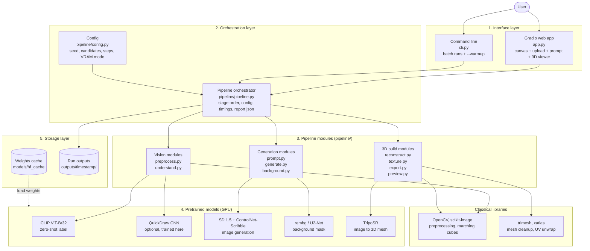
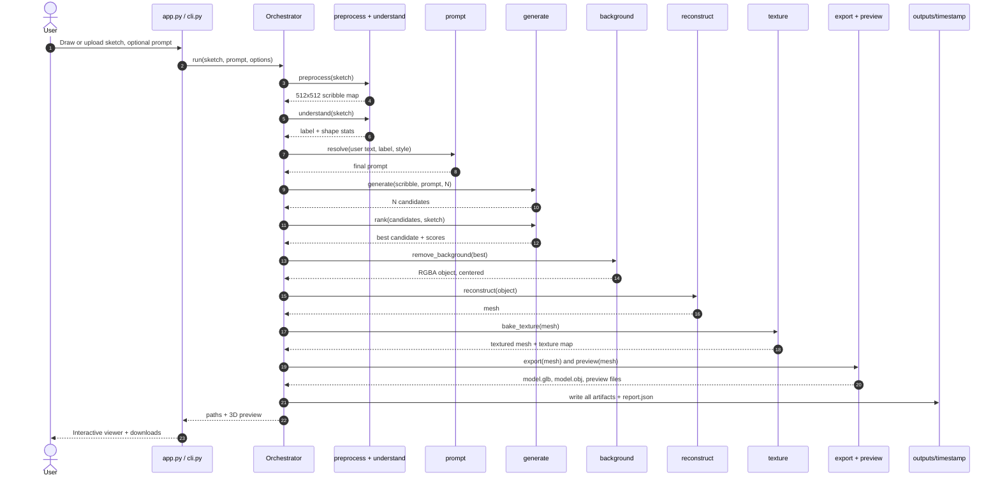
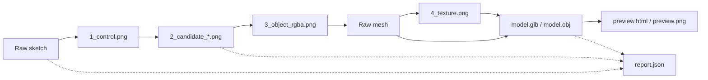
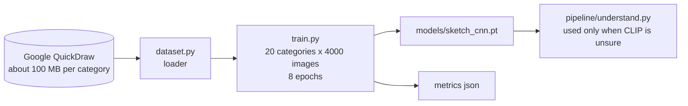
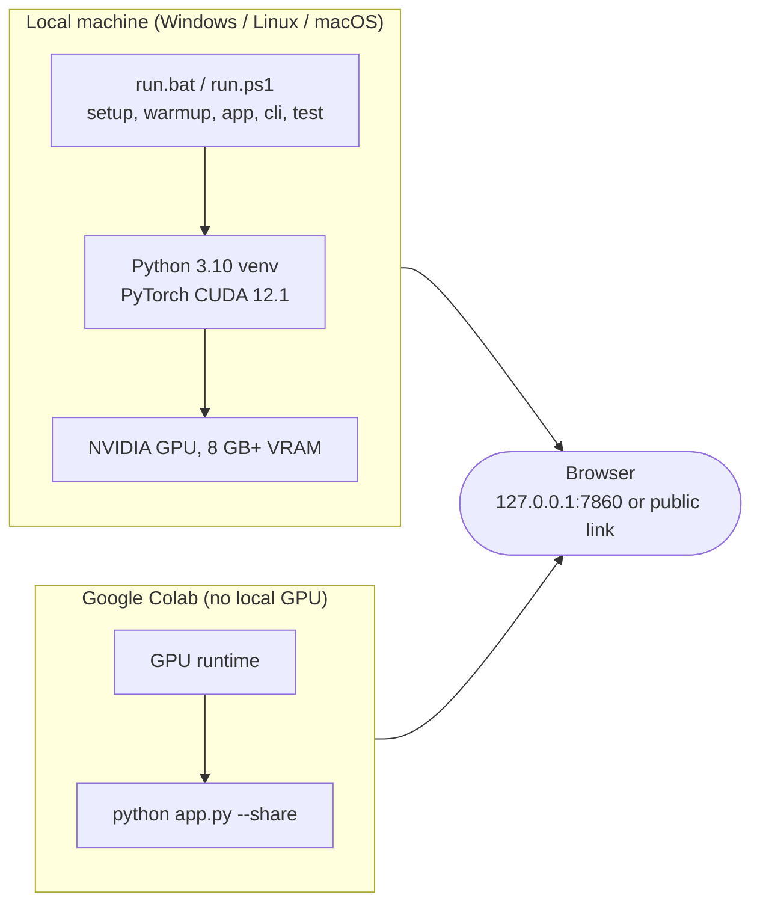

# Sketch2Shape AI: System Architecture and Pipeline

> **From a 2D sketch to a textured 3D asset.** Draw a rough sketch (or upload one), optionally add a text prompt, and get a `.glb` / `.obj` 3D model in under a minute on a consumer GPU.
> Built by **Team Mavericks** for **TechZephyr 4.0 (IIT Bhubaneswar)**, *Sketch2Shape AI: 24-hour live hackathon, Computer Vision & Generative AI*.

All diagrams in this document are written in [Mermaid](https://mermaid.js.org/) and render natively on GitHub.

---

## Table of contents

1. [Overview](#1-overview)
2. [System architecture](#2-system-architecture)
3. [Repository layout](#3-repository-layout)
4. [Pipeline architecture (stage by stage)](#4-pipeline-architecture-stage-by-stage)
5. [Pipeline flow (with decisions and fallbacks)](#5-pipeline-flow-with-decisions-and-fallbacks)
6. [Execution sequence](#6-execution-sequence)
7. [Data artifacts per run](#7-data-artifacts-per-run)
8. [Core algorithms](#8-core-algorithms)
9. [Models and third-party components](#9-models-and-third-party-components)
10. [Key implementation decisions](#10-key-implementation-decisions)
11. [Optional: sketch classifier training flow](#11-optional-sketch-classifier-training-flow)
12. [Deployment, hardware and reproducibility](#12-deployment-hardware-and-reproducibility)
13. [Testing strategy](#13-testing-strategy)
14. [Limitations](#14-limitations)

---

## 1. Overview

Sketch2Shape AI is an end-to-end generative pipeline that converts a hand-drawn 2D sketch into a textured, exportable 3D model.

| Aspect | Description |
|---|---|
| **Input** | A sketch drawn in the in-browser canvas or an uploaded image, plus an optional text prompt |
| **Output** | `model.glb`, `model.obj`, a baked UV texture, an interactive preview, and a JSON run report |
| **Core idea** | Use ControlNet to force a diffusion model to follow the user's strokes, then lift the resulting image to 3D with a feed-forward reconstruction model |
| **Runtime** | Under a minute per model on a consumer GPU (NVIDIA, 8 GB VRAM minimum) |
| **Cost** | No paid external APIs. The internet is only needed to download weights and for the browser-side 3D viewer script |

### The ten required stages

| # | Stage | Module | Technique |
|---|---|---|---|
| 1 | Sketch input | `app.py`, `cli.py` | In-browser canvas (brush, eraser, undo, clear) and image upload |
| 2 | Image preprocessing | `pipeline/preprocess.py` | Denoise, contrast stretch, auto-invert, Otsu, crop/center, 512x512 scribble map |
| 3 | Sketch understanding | `pipeline/understand.py` | Contours, symmetry, silhouette, CLIP zero-shot label, optional trained CNN |
| 4 | Background removal | `pipeline/background.py` | rembg (U2-Net) and foreground centering |
| 5 | Text prompt | `pipeline/prompt.py` | Optional; user text > detected label > default; style presets |
| 6 | AI image refinement | `pipeline/generate.py` | SD 1.5 + ControlNet-Scribble, N candidates ranked by sketch fidelity, optional img2img polish |
| 7 | 3D reconstruction | `pipeline/reconstruct.py` | TripoSR (image to mesh); no-AI fallback for emergencies |
| 8 | Texture generation | `pipeline/texture.py` | xatlas UV unwrap and baked 1024x1024 texture map |
| 9 | 3D preview | `pipeline/preview.py`, `app.py` | Interactive viewer in the app, standalone `preview.html`, multi-view `preview.png` |
| 10 | 3D export | `pipeline/export.py` | Validated `.glb` and `.obj`, files re-opened after export |

---

## 2. System architecture

The system has five layers. Both user interfaces call a single orchestrator, which drives the pipeline modules. The modules in turn call pretrained models that are loaded from a local weights cache.



### Layer responsibilities

| Layer | Responsibility |
|---|---|
| **Interface** | Collect the sketch and prompt, show progress, render the 3D viewer, offer downloads. `app.py` (Gradio) and `cli.py` share the same backend |
| **Orchestration** | Run stages in order, pass artifacts between them, measure per-stage timings, write `report.json`, and apply fallbacks |
| **Pipeline modules** | One Python module per stage, each independently testable |
| **Pretrained models** | Heavy neural components, loaded once from the local cache and run on the GPU |
| **Storage** | A weights cache (about 10 GB, downloaded once) and one timestamped folder per run |

---

## 3. Repository layout

```
sketch2shape-ai/
├── app.py               Gradio web app (canvas + upload + prompt + 3D viewer + downloads)
├── cli.py               command-line interface (also --warmup to pre-download models)
├── create_examples.py   generates 6 test sketches into examples/
├── dataset.py           Google QuickDraw loader (for the optional classifier)
├── train.py             trains the optional sketch classifier -> models/sketch_cnn.pt
├── run.bat / run.ps1    one-command setup and launchers for Windows
├── requirements.txt
├── pipeline/            config, preprocess, understand, prompt, generate, background,
│                        reconstruct, texture, export, preview, classifier, pipeline (orchestrator)
├── examples/            input sketches (mug, chair, car, house, lamp, bottle)
├── models/              TripoSR source (cloned), Hugging Face cache, trained classifier
├── outputs/             one timestamped folder per run (git-ignored)
└── tests/               unit tests (CPU only)
```

---

## 4. Pipeline architecture (stage by stage)

Each stage has a defined input, a defined output, and writes an intermediate artifact so every step of a run can be inspected.

```mermaid
flowchart LR
    S1["1. Sketch input<br/>app.py / cli.py"]
    S2["2. Preprocess<br/>preprocess.py"]
    S3["3. Understand<br/>understand.py"]
    S4["4. Prompt<br/>prompt.py"]
    S5["5. Generate<br/>generate.py"]
    S6["6. Rank<br/>generate.py"]
    S7["7. Remove background<br/>background.py"]
    S8["8. Reconstruct<br/>reconstruct.py"]
    S9["9. Texture<br/>texture.py"]
    S10["10. Export<br/>export.py"]
    S11["11. Preview<br/>preview.py"]

    S1 --> S2 --> S3 --> S4 --> S5 --> S6 --> S7 --> S8 --> S9 --> S10 --> S11
```



### Stage specification

| Stage | Input | Processing | Output |
|---|---|---|---|
| **1. Sketch input** | Canvas strokes or uploaded image | Capture the drawing; the canvas supports brush, eraser, undo and clear | Raw sketch image |
| **2. Preprocess** | Raw sketch | Denoise, contrast stretch, auto-invert (dark-on-light vs light-on-dark), Otsu threshold, crop and center | `1_control.png`: a 512x512 scribble map used as the ControlNet condition |
| **3. Understand** | Cleaned sketch | Extract contours, measure symmetry and silhouette; get a CLIP zero-shot label; consult the optional CNN when CLIP is unsure | Detected label and shape statistics |
| **4. Prompt** | User text (optional), detected label, style preset | Resolve the final prompt with priority: user text > detected label > default | Final text prompt |
| **5. Generate** | Scribble map and prompt | SD 1.5 with ControlNet-Scribble produces N candidate images, with optional img2img polish | `2_candidate_*.png` |
| **6. Rank** | N candidates and the original sketch | Score each candidate by sketch fidelity and select the best | Best candidate image |
| **7. Remove background** | Best candidate | rembg (U2-Net) mask, then center the foreground | `3_object_rgba.png` |
| **8. Reconstruct** | Object RGBA image | TripoSR feed-forward image-to-mesh; marching cubes extracts the surface | Raw mesh |
| **9. Texture** | Mesh | Clean up the mesh, unwrap UVs with xatlas, bake a 1024x1024 texture from TripoSR vertex colours | Textured mesh and `4_texture.png` |
| **10. Export** | Textured mesh | Write `.glb` and `.obj`, then re-open both files to validate them | `model.glb`, `model.obj` |
| **11. Preview** | Exported model | Render an interactive viewer and a 4-angle image | `preview.html`, `preview.png` |

---

## 5. Pipeline flow (with decisions and fallbacks)

This diagram shows the full control flow, including the decision points and the fallback paths that keep a demo from failing.

```mermaid
flowchart TD
    START(["Start: sketch + optional prompt"]) --> PRE["Preprocess<br/>denoise, auto-invert, Otsu<br/>crop and center, 512x512 scribble map"]
    PRE --> UND["Understand<br/>contours, symmetry, silhouette"]
    UND --> CLIPQ["CLIP zero-shot label"]
    CLIPQ --> CONF{"CLIP confident?"}
    CONF -- "yes" --> LABEL["Use CLIP label"]
    CONF -- "no" --> CNNQ{"Trained CNN<br/>available?"}
    CNNQ -- "yes" --> CNNH["Use QuickDraw CNN hint"]
    CNNQ -- "no" --> LABEL
    CNNH --> LABEL

    LABEL --> UP{"User typed<br/>a prompt?"}
    UP -- "yes" --> PUSER["Use user text"]
    UP -- "no" --> PAUTO["Use detected label<br/>or default prompt"]
    PUSER --> PSTYLE["Apply style preset"]
    PAUTO --> PSTYLE

    PSTYLE --> GEN["Generate N candidates<br/>SD 1.5 + ControlNet-Scribble"]
    GEN --> RANK["Rank by sketch fidelity<br/>0.5 x edge share + 0.5 x silhouette IoU"]
    RANK --> BEST["Select best candidate"]
    BEST --> REF{"Refine<br/>enabled?"}
    REF -- "yes" --> IMG2IMG["img2img polish"]
    REF -- "no" --> BG
    IMG2IMG --> BG["Remove background<br/>rembg U2-Net, center object"]

    BG --> TRIPO{"TripoSR<br/>succeeds?"}
    TRIPO -- "yes" --> MESH["Image to mesh<br/>TripoSR + marching cubes"]
    TRIPO -- "no" --> FALL["Fallback: silhouette inflation<br/>low fidelity, keeps demo alive"]
    MESH --> CLEAN
    FALL --> CLEAN["Mesh cleanup"]

    CLEAN --> VALID{"Mesh valid?<br/>flat meshes rejected"}
    VALID -- "no" --> REJECT(["Rejected by validator"])
    VALID -- "yes" --> UV["UV unwrap with xatlas"]
    UV --> BAKE{"Texture bake<br/>succeeds?"}
    BAKE -- "yes" --> TEX["1024x1024 baked texture"]
    BAKE -- "no" --> VCOL["Keep vertex colours only"]

    TEX --> EXPORT["Export model.glb + model.obj"]
    VCOL --> EXPORT
    EXPORT --> REOPEN["Re-open exported files<br/>to verify they load"]
    REOPEN --> PREV["Preview<br/>viewer + 4-angle PNG"]
    PREV --> REPORT["Write report.json<br/>prompt, label, scores, timings, hardware, mesh stats"]
    REPORT --> DONE(["Done: outputs/timestamp/"])
```



### Branch summary

| Decision point | Condition | Behaviour |
|---|---|---|
| **Label source** | CLIP unsure and a trained CNN exists | The CNN provides a second opinion; otherwise the CLIP label is used |
| **Prompt source** | User typed text | User text always wins over the detected label |
| **Reconstruction** | TripoSR unavailable or fails | Silhouette-inflation fallback produces a low-fidelity mesh so the run still completes |
| **Mesh validation** | Mesh is flat or degenerate | The validator rejects it |
| **Texture baking** | xatlas bake fails | The model still exports using TripoSR's per-vertex colours |
| **Export** | Files written | Both files are re-opened to confirm they are readable |

---

## 6. Execution sequence

The order of calls from the user's click to the final files:



---

## 7. Data artifacts per run

Each run creates `outputs/<timestamp>/`:

| File | Content |
|---|---|
| `model.glb`, `model.obj` | The 3D asset (open in Blender, Windows 3D Viewer, or any glTF viewer) |
| `4_texture.png` | Baked UV texture (when baking succeeds) |
| `preview.html`, `preview.png` | Interactive viewer page and 4-angle render |
| `1_control.png` | The preprocessed 512x512 scribble map |
| `2_candidate_*.png` | The N generated candidate images |
| `3_object_rgba.png` | The selected candidate with its background removed |
| `report.json` | Prompt, detected label, fidelity scores, timings per stage, hardware, mesh statistics |

### Artifact lineage



---

## 8. Core algorithms

### 8.1 Candidate ranking (sketch fidelity)

Diffusion models can drift from the input. To keep the result tied to the user's drawing, every candidate is scored against the original sketch:

```
score = 0.5 * edge_share + 0.5 * silhouette_IoU

edge_share      = fraction of the user's strokes that still appear as edges
                  in the generated image
silhouette_IoU  = intersection over union between the user's filled silhouette
                  and the generated object's mask
```

The candidate with the highest score is passed to background removal. The scores are saved in `report.json`.

### 8.2 Prompt resolution

```
final_prompt = user_text       if the user typed one
             = detected_label  otherwise (CLIP, or CNN hint if CLIP is unsure)
             = default prompt  if nothing is detected

then the selected style preset is applied
```

### 8.3 Label detection

1. Extract contours, symmetry and silhouette statistics from the sketch.
2. Run CLIP ViT-B/32 zero-shot classification to get a label.
3. If CLIP is unsure and a trained `models/sketch_cnn.pt` exists, use the QuickDraw CNN as a second opinion.
4. Treat all labels as hints. A user prompt always wins.

### 8.4 Surface extraction

TripoSR predicts an implicit surface and marching cubes converts it to a mesh. The repo registers a scikit-image marching-cubes implementation under the name `torchmcubes` (`pipeline/reconstruct.py::install_mcubes_stub`), so no native compilation is needed.

### 8.5 Texture baking

1. Unwrap the cleaned mesh to UV space with xatlas.
2. Bake TripoSR's per-vertex colours into a 1024x1024 texture (per-triangle colour).
3. If baking fails, the mesh keeps its vertex colours.

---

## 9. Models and third-party components

| Component | Role in pipeline | Source | License |
|---|---|---|---|
| Stable Diffusion 1.5 | Image generation | `stable-diffusion-v1-5/stable-diffusion-v1-5` (Hugging Face) | CreativeML OpenRAIL-M |
| ControlNet scribble | Conditions generation on the sketch | `lllyasviel/sd-controlnet-scribble` | CreativeML OpenRAIL-M |
| TripoSR | Single-image 3D reconstruction | github.com/VAST-AI-Research/TripoSR, weights `stabilityai/TripoSR` | MIT |
| rembg / U2-Net | Background removal | github.com/danielgatis/rembg | MIT |
| CLIP ViT-B/32 | Zero-shot sketch label | `openai/clip-vit-base-patch32` | MIT |
| QuickDraw dataset (optional) | Trains the small classifier | Google Creative Lab | CC BY 4.0 |
| Diffusers, Transformers, PyTorch, OpenCV, trimesh, xatlas, scikit-image, Gradio | Runtime libraries | PyPI | Apache-2.0 / BSD / MIT |

The only model **trained** in this repository is the small QuickDraw CNN. All other models are pretrained and used as published. No paid external APIs are used.

---

## 10. Key implementation decisions

### 10.1 Condition generation on the sketch with ControlNet-Scribble
A plain text-to-image model would ignore the user's drawing. ControlNet-Scribble takes the 512x512 scribble map as a hard structural condition, so the generated image follows the user's strokes and proportions.

### 10.2 Generate several candidates and rank them
A single diffusion sample can drift from the sketch. Generating N candidates and ranking them by edge share and silhouette IoU selects the sample closest to the user's intent. This is a cheap, model-free way to improve fidelity. The `--seed` flag (default 42) makes the sampling repeatable on the same hardware.

### 10.3 Use a feed-forward image-to-3D model
TripoSR reconstructs a mesh from a single image in one forward pass, which is what makes a runtime of under a minute possible on a consumer GPU. Per-object optimisation methods would be far slower.

### 10.4 Remove the background before reconstruction
Single-image 3D models expect an isolated object. Running rembg and centering the foreground first stops the background from being reconstructed as geometry and keeps the object centred in the reconstruction volume.

### 10.5 CLIP first, trained CNN only as a second opinion
CLIP generalises to arbitrary sketches without training. The QuickDraw CNN is only consulted when CLIP is unsure, because QuickDraw doodles differ from real user sketches. Both are treated as hints, and a user prompt always wins.

### 10.6 Optional text prompt with a clear priority order
The prompt is optional so a user can submit only a drawing. Priority is user text, then the detected label, then a default. This keeps the interface simple while letting power users stay in control.

### 10.7 Replace `torchmcubes` with a scikit-image implementation
`torchmcubes` must be built against an installed PyTorch and is the most common install failure on Windows. The repo registers a scikit-image marching-cubes implementation under that name, which removes the compile step entirely.

### 10.8 Automatic low-VRAM mode
The pipeline has to run on consumer hardware. Below 12 GB of VRAM, low-VRAM mode switches on automatically. The minimum supported card is an 8 GB NVIDIA GPU.

### 10.9 A fallback path so a demo never dies
If TripoSR cannot produce a mesh, silhouette inflation generates a low-fidelity mesh so the run still ends with a downloadable model. This is explicitly an emergency path, and the README flags it as low fidelity.

### 10.10 Validate everything that is exported
Flat meshes are rejected by the validator, and exported `.glb` and `.obj` files are re-opened after writing to confirm they load. This prevents silent corruption.

### 10.11 Texture baking is best-effort
Baking via xatlas is attempted, but if it fails the model still exports with its vertex colours. A cosmetic failure should not block delivery of the mesh.

### 10.12 One orchestrator behind both interfaces
`app.py` (Gradio) and `cli.py` call the same orchestrator, so the web app and batch runs behave identically. This also makes the pipeline easy to test and to run headless on Google Colab with `python app.py --share`.

### 10.13 Every run is auditable
Each run writes intermediate images for every stage and a `report.json` containing the prompt, detected label, fidelity scores, per-stage timings, hardware and mesh statistics. This makes results reproducible and supports honest performance reporting.

### 10.14 Local-first, no paid APIs
All models run locally from a Hugging Face cache (`models/hf_cache`, overridable with `HF_HOME`). The internet is only needed to download weights once and to load the browser-side 3D viewer script.

---

## 11. Optional: sketch classifier training flow

The only model trained in this repo is a small CNN that gives a second opinion on what a sketch shows.



```
run.bat train --quick      # smoke test: 5 categories, about 1 minute after download
run.bat train              # 20 categories x 4000 images, 8 epochs
```

QuickDraw doodles differ from real sketches, so the classifier's predictions are treated as hints only.

---

## 12. Deployment, hardware and reproducibility

### Deployment topology



### Requirements

| Item | Value |
|---|---|
| Python | 3.10 (3.11 also works) |
| GPU | NVIDIA with at least 8 GB VRAM and a recent driver (`nvidia-smi` must work) |
| Disk | About 15 GB free; weights download is about 10 GB |
| Weights location | `models/hf_cache` (set `HF_HOME` to override) |
| Random seed | `--seed` (default 42) makes candidate generation repeatable on the same hardware |
| Low-VRAM mode | Switches on automatically below 12 GB |

### Quick start

```
git clone https://github.com/<your-username>/sketch2shape-ai.git
cd sketch2shape-ai
run.bat setup      :: venv + PyTorch (CUDA 12.1) + dependencies + TripoSR clone
run.bat warmup     :: downloads about 10 GB of model weights once
run.bat app        :: opens http://127.0.0.1:7860
```

### Usage examples

```
run.bat app --share                                   :: web UI with a public link
run.bat cli examples\mug.png --prompt "red ceramic mug" --style ceramic
run.bat cli examples\chair.png                        :: prompt is optional
run.bat cli examples\car.png --candidates 4 --refine  :: more candidates + img2img polish
run.bat test                                          :: unit tests
```

---

## 13. Testing strategy

`run.bat test` runs `tests/test_cpu.py`, which needs no GPU. It covers:

- Preprocessing, including inverted and empty inputs
- Shape statistics
- Prompt logic
- Candidate scoring
- Mesh validation (flat meshes are rejected)
- Export round-trip
- UV texture baking
- Classifier tensor shapes

Tests that need `trimesh`, `torch` or `xatlas` skip automatically if those packages are missing. Full end-to-end verification needs a GPU:

```
run.bat cli examples\mug.png
```

Then open the resulting `model.glb`.

---

## 14. Limitations

- Hidden sides are inferred, not recovered; the back of the object is plausible but not exact.
- Thin structures, very abstract doodles and multi-object scenes can fail or drift from the sketch.
- The texture is baked from TripoSR's per-vertex colours (per-triangle colour at 1024x1024); it is not a repainted PBR material.
- CLIP and QuickDraw labels are hints and can be wrong; a user prompt always wins.
- Output is a good starting mesh, not production topology, and not 3D-print-ready.
- Fallback mode (silhouette inflation) is low fidelity and exists only so a demo never dies.

---

## Acknowledgements

TripoSR (Stability AI and Tripo AI), Stable Diffusion (CompVis / Stability AI / Runway), ControlNet (L. Zhang et al.), rembg (D. Gatis), CLIP (OpenAI), Google QuickDraw, Hugging Face Diffusers, trimesh, xatlas.

## License

MIT for this repository's code (see `LICENSE`). The pretrained models keep their own licenses listed in [section 9](#9-models-and-third-party-components).
